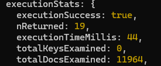
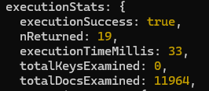

# Database Performance Study: MongoDB & Neo4j

Designing, querying and optimising the a Stack Overflow dataset in a **document database** (MongoDB) and a **graph database** (Neo4j), measuring how the design choices affect query performance. Built for the Large-Scale Databases module of my Computer Science BSc at Cardiff University, 2024.

The dataset was provided for the module and isn't included, so the scripts are here to read rather than to run as-is.

## Key results

| Experiment | Before | After | Change |
|---|---|---|---|
| MongoDB query 2i: referenced → embedded design | 44 ms | 33 ms | 25% faster |
| MongoDB query 2ii: referenced → embedded design | 47 ms | 29 ms | 38% faster |
| Neo4j query i: adding indexes on badge name and date | 52,489 db hits (11 steps) | 34,198 db hits (10 steps) | 35% fewer hits |

## 1: MongoDB
- **database_a (referenced):** separate collections joined at query time with `$lookup`
- **database_b (embedded):** built with aggregation pipelines that embed related documents, e.g. each question stores its author, comments and accepted answer
- Both designs answered the same questions with identical results and examined the same number of documents, but the embedded design ran faster as it needed fewer joins

  
  

**The trade-off:** embedding duplicates data. Embedding *everything* hit MongoDB's 16 MB document limit, and at the full dataset's scale (around 401 GB) the duplication would waste storage and make updates slow and error-prone. A better production design would be a **hybrid** (embed only frequently read fields, reference the rest), with **sharding** on `id` to scale horizontally.

## 2: Neo4j
- Imported the CSVs into a graph with uniqueness constraints and lookup indexes, linked by relationships such as `POSTED`, `ACHIEVED`, `ACCEPTED_ANS`, `ANS_TO` and `REPLIED_TO`
- Used `PROFILE` to break queries into their execution steps. The badge name/date filter was the most expensive step (25,036 hits), so I indexed those two properties
- Extended the model with `Collections` nodes built from question tags, so questions and answers can be browsed by topic (e.g. `node.js`, `c#`)

## Repository contents
| File | What it does |
|---|---|
| `mongodb/01_build_embedded_collections.js` | Aggregation pipelines that build the embedded collections |
| `mongodb/02_query_comparison.js` | The comparison queries with `explain("executionStats")` |
| `neo4j/01_import.cypher` | Constraints and CSV import |
| `neo4j/02_indexes_and_relationships.cypher` | Lookup indexes and relationship creation |
| `neo4j/03_queries_and_profiling.cypher` | Queries, `PROFILE` results and the index optimisation |
| `neo4j/04_collections_model.cypher` | The tag-based collections extension |

